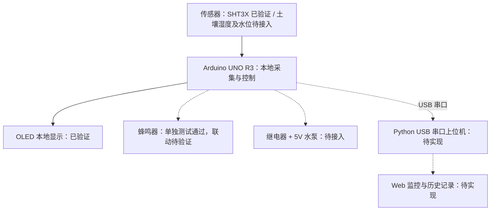

# 系统设计（规划）

当前已实现：Arduino + SHT3X + OLED 本地实时监测。下图中其余模块均属于后续计划。

## 预期灌溉逻辑

1. 读取并校准土壤湿度，检查水箱水位和传感器有效性。
2. 土壤低于启动阈值、且安全条件满足时，短时开启水泵。
3. 关闭水泵、等待水分渗透，再读取土壤湿度。
4. 达到目标阈值即结束；未达到时，在最大运行时间与脉冲次数限制内继续。
5. 缺水、超时或传感器异常时关闭水泵并记录故障。

算法参数等待实物测试确定，不将其视为已验证功能。
