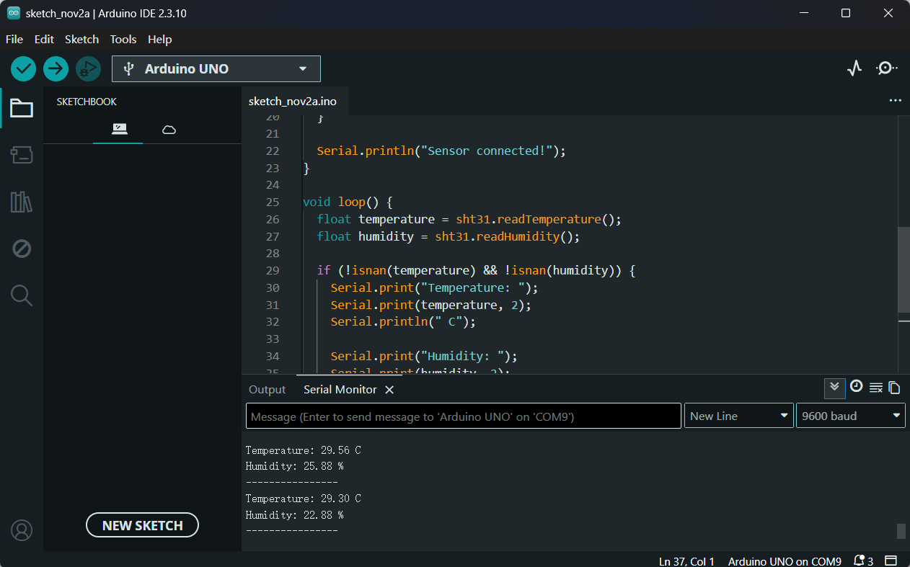
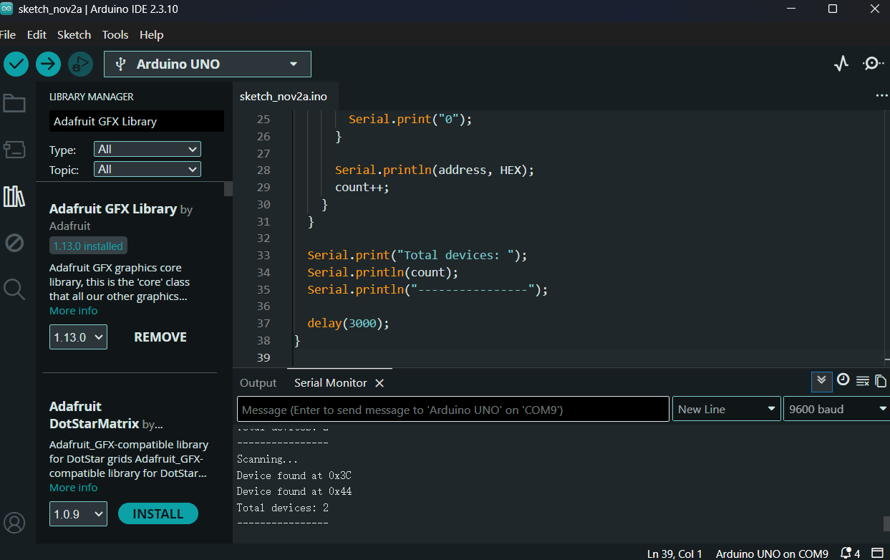

# 测试与证据

记录范围：截至 2026-11-02。实验结论依据已有 Arduino IDE 截图及实际操作反馈。

| 测试编号 | 步骤 | 结果 | 证据 |
| --- | --- | --- | --- |
| T-01 | Arduino Blink 程序烧录与板载 LED 闪烁 | 通过 | 实际操作确认，无截图留存 |
| T-02 | 高电平触发蜂鸣器 D8 周期鸣响 | 通过 | 实际操作确认，无截图留存 |
| T-03 | SHT3X 通过串口输出温湿度 | 通过 | [串口截图](images/sht3x_serial.png) |
| T-04 | 扫描 I²C 总线 | 通过：`0x3C`、`0x44`，共 2 个设备 | [扫描截图](images/i2c_scan.png) |
| T-05 | SHT3X 温湿度实时更新到 OLED | 通过 | 实际操作确认，无屏幕运行照片留存 |
| T-06 | 温湿度阈值触发蜂鸣器报警 | 待验证 | — |
| T-07 | 土壤湿度采集及阈值灌溉 | 待采购 / 未实现 | — |
| T-08 | 水位保护、故障停泵 | 待采购 / 未实现 | — |

串口截图中的温湿度为当时传感器输出样本，**不代表经过专业校准的测量精度**。

## 实测截图

**SHT3X 串口温湿度输出**

**I²C 设备识别：0x3C 与 0x44**

